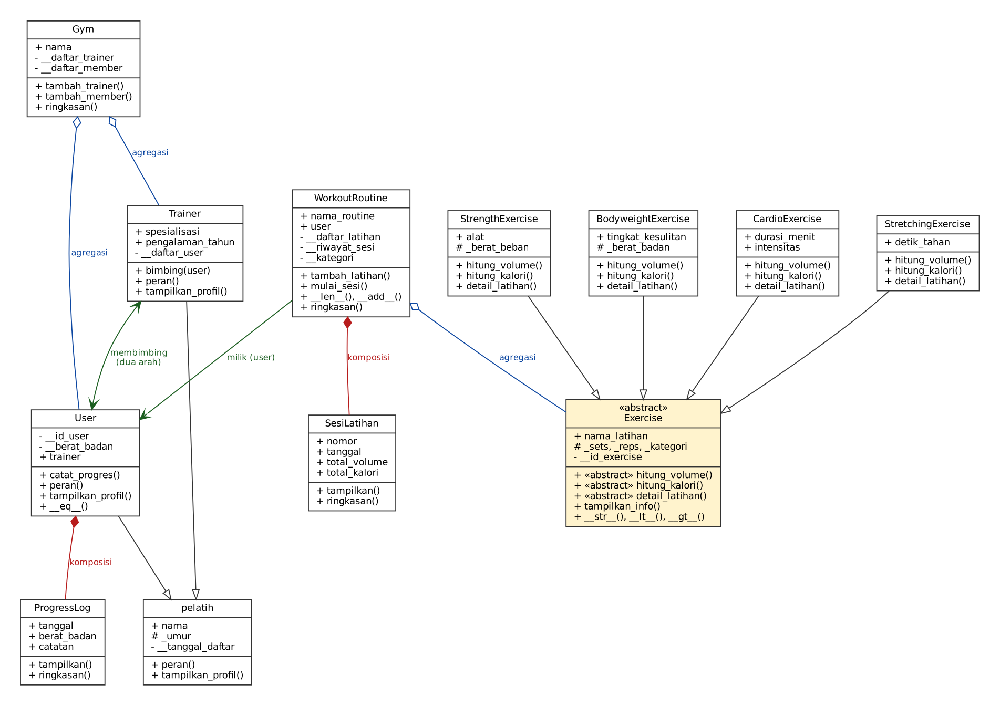
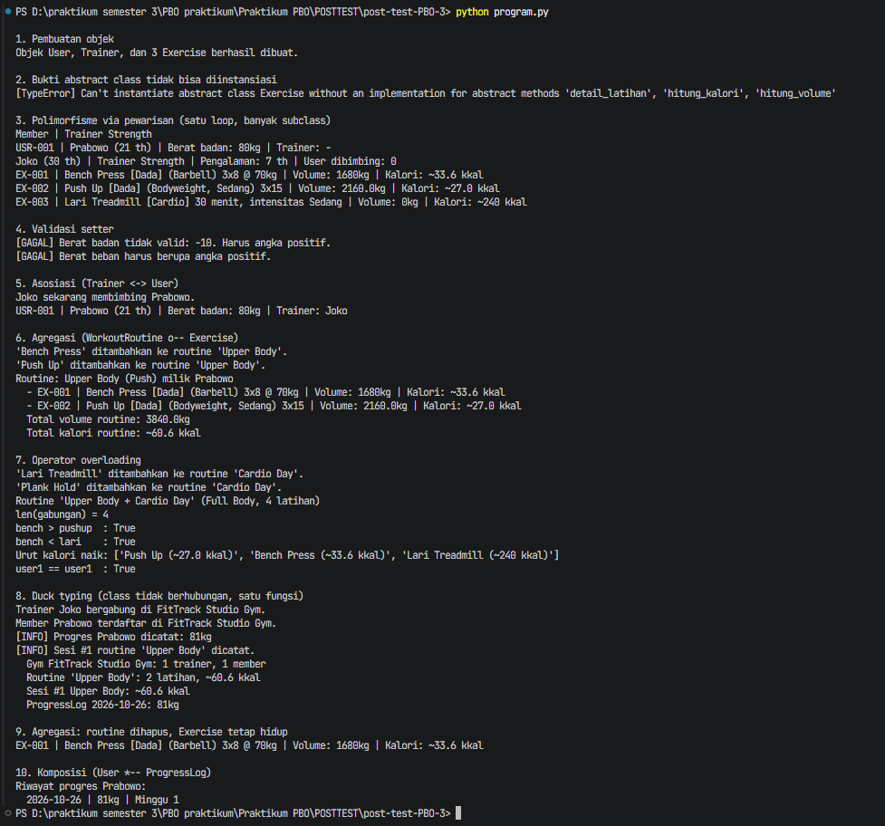

Nama : Denny Mulia
kelas : A1'25
NIM : 2509106011
POSTTEST : 3


# FitTrack Pro : Sistem Monitoring Progres Otot dan Management Workout

## Deskripsi Program

FitTrack Pro adalah program Python berbasis OOP buat mencatat progres
berat badan member gym dan mengatur routine latihan. Program ini punya dua
belas class yang berinteraksi lewat pewarisan (inheritance), relasi antar
objek (asosiasi, agregasi, komposisi), abstraksi (abstract class), dan
polimorfisme.

Ada dua hierarki pewarisan. Yang pertama class `pelatih` sebagai induk dari
`User` dan `Trainer`. Yang kedua class abstrak `Exercise` sebagai induk dari
`StrengthExercise`, `BodyweightExercise`, `CardioExercise`, dan
`StretchingExercise`. Class `WorkoutRoutine` menghubungkan `User`,
`Exercise`, dan `SesiLatihan`, sementara `ProgressLog` dan `Gym` jadi class
pendukungnya.

## Class Diagram



### Penjelasan Relasi

**Asosiasi**: `Trainer` <-> `User` (dua arah) dan `WorkoutRoutine` -> `User`.
Di kode, `Trainer.bimbing(user)` memasukkan user ke `__daftar_user` sekaligus
mengisi `user.trainer = self`, sedangkan `WorkoutRoutine` menyimpan `user`
sebagai pemiliknya. Relasinya cuma "saling kenal", dan keduanya tetap hidup
sendiri-sendiri tanpa ada yang memiliki yang lain.

**Agregasi**: `WorkoutRoutine` o-- `Exercise`, `Gym` o-- `Trainer`, dan
`Gym` o-- `User`. Objek bagiannya (Exercise, Trainer, User) dibuat di luar
lalu dimasukkan lewat `tambah_latihan`, `tambah_trainer`, dan
`tambah_member`. Karena itu mereka tetap hidup walau induknya dihapus,
buktinya di pengujian `bench` tetap bisa dipakai setelah `del routine`.
Satu Exercise juga bisa dipakai bersama oleh beberapa routine.

**Komposisi**: `User` *-- `ProgressLog` dan `WorkoutRoutine` *--
`SesiLatihan`. Objek bagiannya dibuat di dalam induknya, yaitu di method
`catat_progres` dan `mulai_sesi`, bukan dari luar. Selain itu, ProgressLog
dan SesiLatihan cuma bermakna sebagai bagian dari user atau routine
tertentu, jadi kalau induknya hilang, bagiannya ikut hilang. Inilah
pembeda dengan agregasi: bagian pada agregasi dibuat di luar dan hidup
mandiri, bagian pada komposisi dibuat di dalam dan nasibnya ikut induk.

## Penerapan Abstraksi

Class `Exercise` adalah abstract class (`class Exercise(ABC)`) dengan tiga
`@abstractmethod`, yaitu `hitung_volume()`, `hitung_kalori()`, dan
`detail_latihan()`.

- Empat subclass (`StrengthExercise`, `BodyweightExercise`,
  `CardioExercise`, `StretchingExercise`) mengimplementasikan ketiga
  abstract method tersebut.
- Method konkret `tampilkan_info()` ada di `Exercise` dan dipakai bersama
  semua subclass. Method ini memanggil tiga abstract method di atas, jadi
  tiap subclass cukup menentukan rumus dan detailnya sendiri (pola seperti
  `jalankan()` pada materi).
- Bukti abstraksi: `Exercise("Latihan Abstrak", 1, 1)` dibungkus
  `try-except TypeError` dan hasilnya tercetak di bagian 2 output (lihat
  screenshot).
- Konsep inheritance tetap dipakai: semua subclass memanggil
  `super().__init__(...)`, punya atribut unik (`alat`, `tingkat_kesulitan`,
  `durasi_menit`, `detik_tahan`), serta atribut protected (`_sets`, `_reps`,
  `_umur`) dan private (`__id_exercise`, `__tanggal_daftar`).

## Penerapan Polimorfisme

1. **Polimorfisme via pewarisan.** `hitung_volume()`, `hitung_kalori()`, dan
   `detail_latihan()` di-override oleh minimal dua subclass dengan perilaku
   berbeda. Dipanggil lewat satu loop `for ex in (bench, pushup, lari):
   ex.tampilkan_info()`. Hal yang sama berlaku untuk `peran()` dan
   `tampilkan_profil()` yang di-override `User` dan `Trainer`, dipanggil
   lewat `for orang in (user1, trainer1)`.
2. **Duck typing.** Class `Gym`, `WorkoutRoutine`, `SesiLatihan`, dan
   `ProgressLog` tidak berhubungan lewat pewarisan, tetapi masing-masing
   punya method `ringkasan()`. Semuanya dipanggil lewat satu fungsi yang
   sama, yaitu `cetak_ringkasan(*daftar_objek)`.
3. **Operator overloading.**
   - `Exercise`: `__str__`, `__lt__`, `__gt__` (dibandingkan dari kalori,
     jadi `sorted()` bisa dipakai langsung ke daftar latihan).
   - `WorkoutRoutine`: `__len__` (jumlah latihan), `__add__` (menggabungkan
     dua routine jadi routine baru), `__str__`.
   - `User`: `__eq__` (sama jika `id_user` sama), `__hash__`, `__str__`.
4. **Tanpa anti-pattern.** Tidak ada rantai `if/elif` yang mengecek `type()`
   atau string jenis latihan. `WorkoutRoutine` cukup memanggil
   `hitung_volume()` dan `hitung_kalori()`, lalu setiap objek menentukan
   hasilnya sendiri.

## Screenshot Output Program

Program dijalankan dengan perintah `python program.py`.



### Bukti Abstract Class Tidak Bisa Diinstansiasi

Pada bagian pengujian nomor 2 di `program.py`, class abstrak `Exercise`
dicoba diinstansiasi langsung di dalam `try-except TypeError`:

```python
try:
    latihan = Exercise("Latihan Abstrak", 1, 1)
except TypeError as e:
    print("[TypeError]", e)
```

Hasilnya Python menolak pembuatan objek dan memunculkan `TypeError`,
karena `Exercise` masih punya tiga abstract method (`hitung_volume`,
`hitung_kalori`, `detail_latihan`) yang belum diimplementasikan. Hasil
outputnya:


